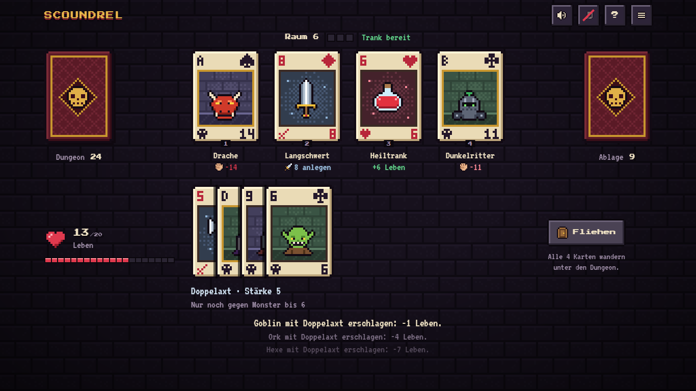

# Scoundrel

A pixel-art browser game based on the solitaire card game **Scoundrel** by Zach Gage and Kurt Bieg (2011). You fight your way through a dungeon of 44 playing cards with 20 health. Monsters, weapons and health potions are dealt face up in front of you.



The game is available in **English and German**. On first launch it follows your browser language: German if it starts with `de`, English otherwise. You can switch at any time on the title screen or with the `EN`/`DE` button in the top bar.

It runs directly in the browser without installation or a build step, on desktop and on phones.

## Built with Claude

This project was programmed entirely with [Claude Code](https://claude.com/claude-code), using the model Claude Opus 5.5. A human wrote the requests and supplied the original rules PDF. Claude wrote the code, the pixel art, the sound and the texts.

| | |
| --- | --- |
| Prompts | 10 |
| Tokens processed | about 47 million |
| … of which output tokens | about 325,000 |

The token figures were measured from the Claude Code session log when this README was written. Most of the processed tokens are cache reads: on every step the model re-reads the conversation so far, which is billed at a much lower rate than new input. The prompts cover the whole history of the repository, from the first game build through Git setup, GitHub Pages, the license and README and the English translation, to the easy dungeon mode.

## Features

- **All 44 cards in pixel art:** 13 monsters from the rat to the dragon, in club and spade color variants, 9 weapons from the cudgel to the rune blade, and health potions in several sizes. All graphics are drawn on canvas at runtime. There are no image files.
- **Original rules** (version 1.0 of August 15, 2011), including the weapon stacking rule and the official scoring.
- **Crisp pixels on every screen:** the layout scales in whole-pixel steps, from phones up to 1920 × 1080.
- **Animation and sound:** cards fly across the table and hits shake the screen. Sound effects and optional chiptune music are generated with WebAudio.
- **Easy dungeon:** a kindly shuffled dungeon that is guaranteed to be beatable (see below).
- **Daily dungeon:** everyone gets the same card order on the same day.
- **Progress in the browser:** best scores, language choice and a running game are kept in the browser's `localStorage`.

## Rules in brief

| Cards | Meaning |
| --- | --- |
| ♣ ♠ Clubs and spades (26) | **Monsters.** Damage equals value: 2–10, Jack 11, Queen 12, King 13, Ace 14 |
| ♦ Diamonds 2–10 (9) | **Weapons.** Reduce a monster's damage by their value |
| ♥ Hearts 2–10 (9) | **Health potions.** Heal their value, never above 20 |

Red face cards, red aces and jokers are removed.

1. There are always 4 cards face up. This is the **room**.
2. You may **flee**. All 4 cards then go to the bottom of the dungeon. You cannot flee twice in a row.
3. If you stay, you take **3 of the 4 cards**, one at a time. The fourth card stays for the next room.
4. **Weapons** must be equipped. Your old weapon and the monsters on it go to the discard pile.
5. **Health potions:** only one works per room. A second one is wasted.
6. **Combat:** barehanded you lose the monster's full value. With your weapon you only lose *monster minus weapon* (at least 0). After that, the weapon only hits monsters **less than or equal** to the last monster it slew.

**Scoring:** if you survive, your remaining health is your score. With exactly 20 health, the value of a health potion is added if it was your last card. If you die, the sum of all remaining monsters is subtracted and your score is negative.

The full rules with an example are in the game under **?**.

## Game modes

| Mode | Dungeon |
| --- | --- |
| New game | Shuffled at random. Not every one of these dungeons can be won. |
| Easy dungeon | Shuffled kindly and checked by a solver: guaranteed to be beatable with health to spare. |
| Daily dungeon | Shuffled at random, but the same for everyone on the same day. |

**How the easy dungeon works.** Random Scoundrel dungeons are often brutal: the built-in solver finds a win for only about one in five of them. The easy dungeon is therefore built on purpose. A strong weapon (8–10) lies in the first room, the monsters come roughly from strong to weak so the weapon stays usable for a long time, further weapons only show up once the monsters are weaker than them, and the potions are spread across the dungeon. A bit of random noise keeps every dungeon different.

Before the game starts, a solver in `js/rules.js` checks the dungeon. Room by room, it computes every possible play (fleeing, or every order of three cards with weapon or fists) and follows the most promising positions (a beam search). A dungeon is only used if the solver finds a win with **at least 10 health left**. The winning line it finds proves that the dungeon can be beaten. About every second candidate passes, so finding one usually takes a fraction of a second. During development, the solver's winning lines were replayed in the real game, and each one ended in exactly the predicted win.

Easy dungeons have their own best score, so they don't inflate the normal one.

## Controls

| Action | Mouse / touch | Keyboard |
| --- | --- | --- |
| Take a card | Click or tap the card | `1` – `4` |
| Fight with weapon | "Weapon" in the fight menu | `W` |
| Fight barehanded | "Fists" in the fight menu | `F` |
| Flee | "Flee" | `F` |
| Sound on/off | Speaker icon | `M` |
| Menu / cancel | Menu icon | `Esc` |

## Play locally

Open `index.html` in a browser. That's all. The pixel fonts load from Google Fonts. Without an internet connection the game uses a fallback font.

You can also use a local web server, for example:

```bash
python -m http.server 8765
```

Then open `http://localhost:8765`.

## Publish with GitHub Pages

1. Push the repository to GitHub.
2. Go to **Settings → Pages → Build and deployment**. Under *Source* choose "Deploy from a branch", branch `main`, folder `/ (root)`.
3. After a short while the game is live at `https://<username>.github.io/<repository>/`.

With a free GitHub account, Pages only works for public repositories.

## Project structure

```text
index.html       Page skeleton and overlays; texts come from js/i18n.js
css/style.css    Styling, pixel grid and narrow-screen layout
js/i18n.js       English and German texts, language detection
js/rules.js      Rules core without DOM: deck, easy-dungeon builder and solver
js/sprites.js    Pixel art: sprites, card renderer, icons, card names
js/audio.js      Sound effects and music with WebAudio
js/game.js       Game logic, rendering, animation and input
build.mjs        Builds a single HTML file with inlined CSS and JS
```

To add a language, add a block to `STR` in `js/i18n.js`, add the card names in `js/sprites.js` and add a button to the language switch in `index.html`.

## Single-file build

For environments that expect exactly one HTML file (for example Claude artifacts), `build.mjs` inlines CSS and JavaScript and leaves out the HTML skeleton:

```bash
node build.mjs
```

The result is written to `dist/scoundrel.html`. The folder is listed in `.gitignore`. GitHub Pages does not need it.

## Credits

- **Game design and rules:** *Scoundrel* by Zach Gage and Kurt Bieg (2011). This project is an unofficial fan adaptation and is not affiliated with the authors.
- **Fonts:** [Press Start 2P](https://fonts.google.com/specimen/Press+Start+2P) by CodeMan38 and [VT323](https://fonts.google.com/specimen/VT323) by Peter Hull, both under the SIL Open Font License and loaded from Google Fonts.

## License

Code and pixel art are released under the [MIT License](LICENSE).
